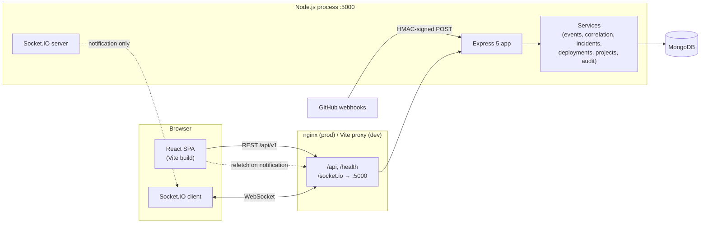
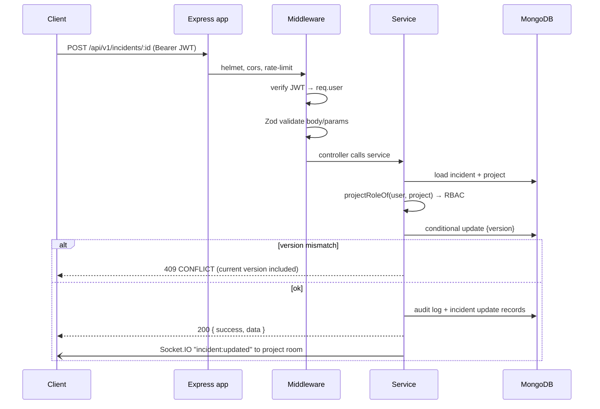
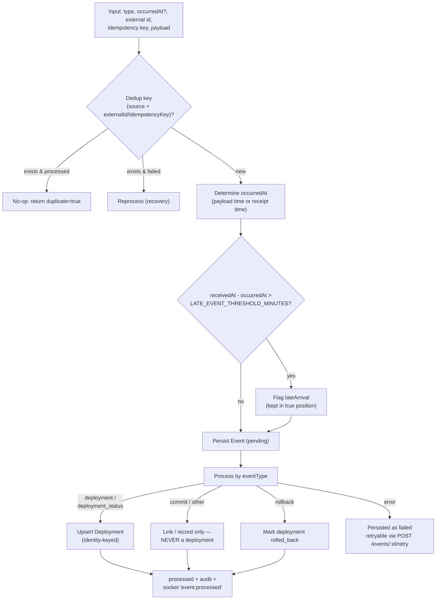
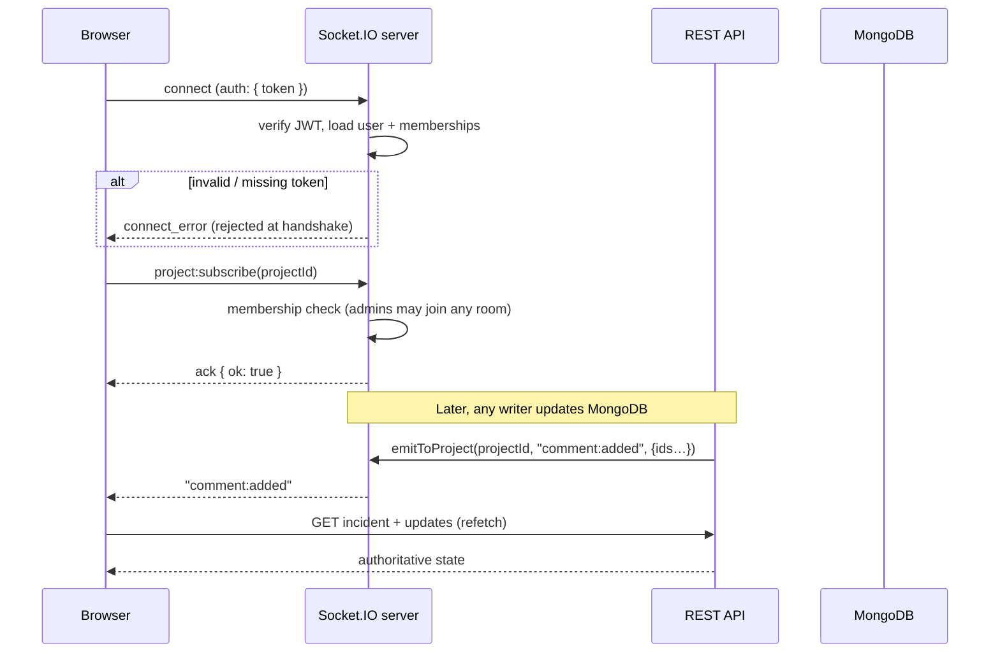

# BuildTrace — Architecture

## 1. System overview

**Principles**

1. **MongoDB is the single source of truth.** Socket.IO messages carry ids and summaries only; every client refetches authoritative state from the REST API on each notification and on reconnect. A dropped or delayed socket can therefore never corrupt the UI.
2. **Thin controllers, fat services.** Controllers validate/authorize/serialize; all business logic (event pipeline, correlation, lifecycle rules) lives in `src/services` where it is unit-testable and reused by the seeder.
3. **Every sensitive act is audited.** `AuditLog` stores actor, action, and before/after snapshots as a separate append-only collection.
4. **Explainability over magic.** The correlation engine is a documented, weighted rule system — see §4.

---

## 2. Request lifecycle

Middleware order in `src/app.js` matters:

1. Helmet + CORS + structured logging
2. **Raw-body webhook mount** (`express.raw`) — before JSON parsing so HMAC signatures verify over exact bytes
3. JSON/urlencoded body parsing
4. Rate limiting (`/api`)
5. Public routes: `/health`, `/api/v1/auth`
6. `requireAuth` → everything else under `/api/v1`
7. 404 + centralized error handler (consistent `{success:false, error:{code,message,details}}` shape)

---

## 3. Event pipeline

Every deployment, commit, rollback, config change or manual note enters through one pipeline (`eventService.ingestEvent`), whether it arrives via REST, webhook or the seeder.

**Ordering guarantees**

- The timeline reads events sorted by `occurredAt` descending with `_id` as a stable tie-break (`{projectId, occurredAt, _id}` index).
- Late arrivals keep their chronological position; they are flagged (`lateArrival`) rather than shoved to the top.
- Events with **no** reliable occurrence time are marked `timestampUncertain` and fall back to receipt time (`occurredAtSource: 'receipt'`).

**Deduplication guarantees**

- `dedupKey` has a database-enforced **partial unique index** (`dedupKey: { $type: 'string' }`), so duplicates are impossible even under concurrent ingestion — the insert fails and the winner wins.
- Internally generated events (no external identity) leave `dedupKey` null and are excluded from the index, so legitimate repeats (e.g. two identical comments) are never merged.
- GitHub deliveries use `X-GitHub-Delivery` as the external id; redeliveries return `duplicate: true` with no side effects.
- Failed events are reprocessed on redelivery/retry — at-least-once + idempotent processing.

---

## 4. Correlation engine (deployment → incident)

Rule-based, transparent, and documented in code (`src/services/correlationService.js`) and in the UI itself.

**Candidates** are deployments that:

1. belong to the same project,
2. occurred **before** the incident's detection time (`incident.createdAt`),
3. fall inside the investigation window (`CORRELATION_WINDOW_MINUTES`, default 60),
4. have status `success` or `rolled_back` — a failed build never served traffic,
5. are not already dismissed by an investigator (associated ones are marked).

**Score = weighted sum of four factors**

| Factor | Weight | Value |
|--------|--------|-------|
| `proximity` | 0.45 | `1 − age / window` (linear decay) |
| `environment` | 0.20 | 1 same env · 0 mismatch · 0.5 unknown |
| `service` | 0.20 | 1 match · 0 mismatch · 0.5 unknown |
| `change_signals` | 0.15 | 70% commit-message keyword overlap + 30% changed-file volume |

All weights are configurable (`CORRELATION_W_*`, must sum to 1.0). Every response includes the weights, the window definition, a methodology note and a per-factor `explanation` string — the UI renders all of it.

**Guardrails**

- Candidates are labelled *suggestions* in API text, docs and UI. Associating a deployment is an explicit investigator action recorded in the audit log (`incident.deployment_associated`), and dismissing one is equally explicit (`incident.deployment_dismissed`).
- The confirmed root cause is a separate, human-authored field (`incident.rootCause`).
- Dismissals persist on the incident, so a dismissed candidate never resurfaces.
- When no candidate exists the API returns `noneFound: true` plus a human-readable `noneFoundMessage` — never a silent empty list.

---

## 5. Realtime design (Socket.IO)

- **Rooms:** `project:<id>`. Users can only subscribe to projects they belong to; global admins may subscribe to any room they explicitly join.
- **Events:** `incident:created|updated|deleted`, `comment:added`, `deployment:created|updated`, `event:processed` — payloads contain ids and summaries only.
- **Client pattern:** handlers bump a `nonce` passed into child components as an effect dependency — lists refetch while preserving filters, pagination and scroll position.
- **Reconnect:** the client re-subscribes and refetches; the header shows a live/reconnecting pill so users always know the connection state.

---

## 6. Security

| Concern | Approach |
|---------|----------|
| Passwords | bcryptjs hashing, 8+ character policy, never logged |
| Sessions | JWT (HS256) with expiry; production boot fails fast if `JWT_SECRET` is the dev default |
| Authorization | RBAC enforced in services (`assertProjectRole`): `viewer < developer < admin`, with global-admin bypass; never trusted from the client |
| Webhooks | HMAC-SHA256 over the raw body, constant-time compare (`crypto.timingSafeEqual`), delivery-id dedup, `401` on mismatch |
| Secrets at rest | Ingest keys stored as a SHA-256 hash; the GitHub webhook secret is stored server-side (write-only) because HMAC verification needs the shared secret — both revealed exactly once at rotation, never returned again, never logged |
| Transport hardening | Helmet security headers, `x-powered-by` disabled, JSON body size caps |
| Abuse | Global API rate limit + stricter auth limiter on login/register |
| Injection | Zod validation on every body/query/params; Mongoose strict schemas; `validateObjectIds` rejects malformed ids before they hit queries |
| Leakage | Pino logging records request shape only (method/url/status) — never headers or bodies |

### RBAC matrix

| Capability | viewer | developer | admin (project) | global admin |
|------------|:------:|:---------:|:---------------:|:------------:|
| Read projects / incidents / deployments / timeline / dashboard | ✅ | ✅ | ✅ | ✅ |
| Comment & investigator notes | ❌ | ✅ | ✅ | ✅ |
| Create/edit incidents, transitions, associate/dismiss candidates, record deployments | ❌ | ✅ | ✅ | ✅ |
| Manage members, rotate secrets, delete incidents, delete project | ❌ | ❌ | ✅ | ✅ |

---

## 7. Frontend architecture

- **Providers:** `AuthProvider` (session from `/auth/me`, auto sign-out on `401`) → `SocketProvider` (one authenticated socket per session) → `ToastProvider` (aria-live feedback) → `BrowserRouter`.
- **API client (`lib/api.js`):** one Axios instance with the Bearer token, envelope unwrapping (`{success,data}` → `data`), and normalized `ApiError`s carrying `status`, `code`, `details` and a `fieldErrors` getter for inline form errors. A `401` broadcasts a single "unauthorized" event so the session is dropped exactly once.
- **Design system:** Tailwind v4 `@theme` tokens (canvas/surface/edge/fg + violet `primary` + cyan `accent` + severity colors), a small in-house UI kit (Button, Badge, Card, Field, Modal, Tabs, Pagination, Feedback) — consistent focus states, 150–300 ms transitions, `prefers-reduced-motion` support, no emoji icons.
- **Routing:** every screen is a lazy route (code-split); the dashboard's chart bundle (Recharts) only loads when the dashboard opens.
- **State & data:** pages own their server state; filters debounce (300–350 ms) into an "applied" state; realtime notifications increment a `nonce` that triggers refetches without resetting user context.

---

## 8. Trade-offs & known limitations

- **JWT in `localStorage`** (vs httpOnly cookies): simpler for a self-contained demo; the API layer mitigates XSS fallout by dropping the session on 401. A production hardening step would move to cookies + CSRF protection.
- **No WebSocket state sync:** deliberate — notifications-only avoids merge conflicts; the cost is one extra GET per notification.
- **Correlation is rule-based, not statistical.** This is a feature (explainability, no training data) not a defect; weights are tunable per deployment.
- **Single-process socket server.** Horizontal scaling would add a Socket.IO Redis adapter; the notification-only design makes this a drop-in change.
