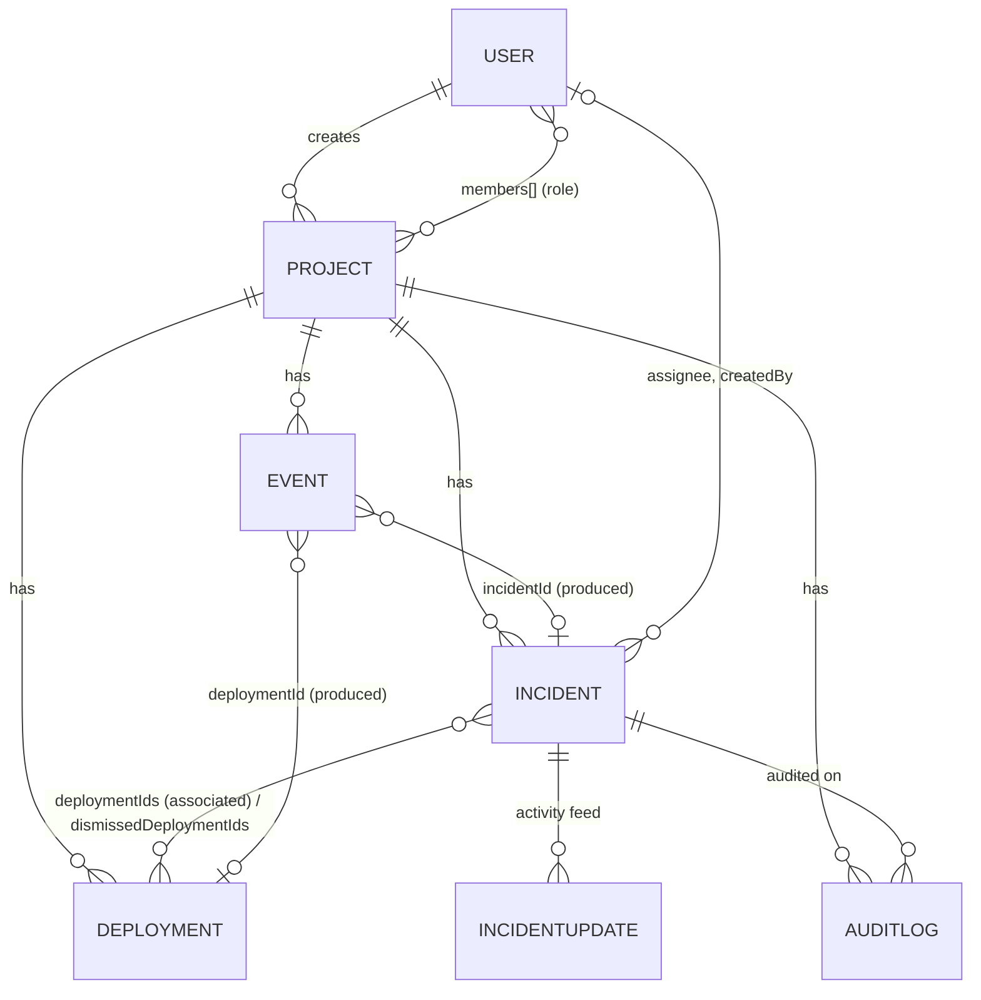

# BuildTrace — Database Schema

MongoDB with Mongoose ODM. Seven collections:

`users` · `projects` · `deployments` · `incidents` · `incidentupdates` · `events` · `auditlogs`

---

## Entity relationships

---

## `users`

| Field | Type | Notes |
|-------|------|-------|
| `name` | string, required, ≤120 | |
| `email` | string, required, **unique**, lowercased | login identity |
| `passwordHash` | string, required, `select:false` | bcryptjs; never returned (`toJSON` strips it) |
| `role` | enum `admin\|developer\|viewer`, default `developer` | global role |
| `createdAt` / `updatedAt` | timestamps | |

Indexes: `email` (unique), `role`.

---

## `projects`

| Field | Type | Notes |
|-------|------|-------|
| `name` | string, required, ≤140 | |
| `slug` | string, required, **unique**, lowercased | URL-safe identifier |
| `description` | string, ≤2000, default `''` | |
| `repositoryUrl` | string, ≤400, http(s)-validated | links GitHub repos to webhooks |
| `createdBy` | ObjectId → User, required | |
| `members[]` | `{ user: ObjectId, role: enum, addedAt }` | embedded membership + per-project role |
| `environments[]` | string[], min 1, default `['production']` | deployment environments for the project |
| `githubWebhookSecret` | string, `select:false` | write-only; stored server-side for HMAC verification, never serialized (stripped in `toJSON`) |
| `ingestKeyHash` | string, `select:false` | hashed API key for non-JWT automation |
| `ingestKeyLast4` | string \| null | display-only suffix so admins can recognize a key |
| `createdAt` / `updatedAt` | timestamps | |

Indexes: `slug` (unique), `members.user` (multikey), text index on `name` + `description`.

**Design notes**
- Membership is embedded (bounded ≤50) because it is always read with the project — no join needed for the RBAC checks on every request.
- Secrets are `select:false` **and** stripped by `toJSON`, double-guarding against accidental serialization.

---

## `deployments`

| Field | Type | Notes |
|-------|------|-------|
| `projectId` | ObjectId → Project, required | |
| `version` | string, default `'unknown'` | e.g. `v2.4.1` |
| `commitSha` | string, lowercased, hex, ≤64 | |
| `environment` | string, required, ≤60 | e.g. `production` |
| `status` | enum `success\|failed\|in_progress\|rolled_back\|cancelled`, default `success` | |
| `actor` | `{ userId, name, type: user\|automation\|unknown }` | allows non-user deployers |
| `occurredAt` | date, required | **when the deployment happened** |
| `receivedAt` | date, required | **when BuildTrace learned about it** |
| `lastStatusAt` | date \| null | staleness guard: out-of-order status updates are ignored |
| `occurredAtTrusted` | boolean, default `true` | false when the source supplied no reliable timestamp |
| `source` | enum (`manual`, `github`, `ci`, …) | |
| `externalId` | string \| null | identity for dedup, e.g. `gh-deployment:12345` |
| `service` | string \| null | used by correlation |
| `commitMessage` | string \| null | keyword signal for correlation |
| `changedFiles[]` / `filesChangedCount` | string[] / number | change-size signal for correlation |
| `url`, `metadata` | string \| null, Mixed | provider links / raw extras |

Indexes:
- **unique partial** `{projectId, source, externalId}` where `externalId` is a string → DB-level duplicate protection; manual deployments (no externalId) are excluded so they never collide.
- `{projectId, occurredAt: -1}`, `{projectId, environment, occurredAt}`, `{projectId, status, occurredAt}` for the filtered lists.

---

## `incidents`

| Field | Type | Notes |
|-------|------|-------|
| `projectId` | ObjectId → Project, required | |
| `title` | string, required, ≤240 | |
| `description` | string, ≤8000 | |
| `severity` | enum `SEV1..SEV4`, default `SEV3` | |
| `status` | enum `open\|investigating\|monitoring\|resolved`, default `open` | transitions validated in the service layer |
| `assigneeId` | ObjectId → User \| null | validated against project membership |
| `environment` / `affectedService` | string \| null | correlation inputs |
| `deploymentIds[]` | ObjectId[] → Deployment | **investigator-confirmed** associations only |
| `dismissedDeploymentIds[]` | ObjectId[] → Deployment | rejected candidates; excluded from future suggestion lists |
| `rootCause` | string \| null, ≤4000 | human-authored, separate from suggestions |
| `resolution` | string \| null, ≤4000 | **required** to transition to `resolved` |
| `createdBy` | ObjectId → User | |
| `resolvedAt` | date \| null | set/cleared by the status machine |
| `signature` | string, indexed | normalized title — powers recurring-issue detection |
| `version` | number, default 0 | **optimistic concurrency** — every write requires the expected version; stale writes get `409` |
| `createdAt` / `updatedAt` | timestamps | `createdAt` is the "detection time" correlation measures against |

Indexes: `{projectId, status, createdAt}`, `{projectId, severity, createdAt}`, `{projectId, createdAt}`, `{projectId, signature}`, `{assigneeId, status}`.

**Design notes**
- `deploymentIds` and `dismissedDeploymentIds` are separate from the computed candidate list: suggestions are never persisted as truth, only investigator decisions are.
- Conditional updates use `findOneAndUpdate({_id, version}, {$inc: {version: 1}})` so concurrency control is atomic at the database, not in application code.

---

## `incidentupdates`

Activity feed entries (comments, investigator notes, system status changes).

| Field | Type | Notes |
|-------|------|-------|
| `incidentId` | ObjectId → Incident, required | |
| `authorId` | ObjectId → User, required | |
| `kind` | enum `comment\|note\|status_change` | `status_change` entries are written by the service on transitions |
| `content` | string, required, ≤8000 | plain text |
| `createdAt` / `updatedAt` | timestamps | conversation order |

Index: `{incidentId, createdAt}` — conversation-ordered pagination.

**Why a separate collection:** the incident document stays small (no unbounded embedded arrays), and the feed is paged independently.

---

## `events`

The chronological backbone and ingestion/dedup ledger.

| Field | Type | Notes |
|-------|------|-------|
| `projectId` | ObjectId → Project, required | |
| `eventType` | enum `deployment\|deployment_status\|rollback\|commit\|incident\|incident_update\|comment\|investigation\|config_change\|other` | |
| `source` | enum (`manual`, `github`, `ci`, `system`, …) | |
| `externalId` | string \| null | provider identity (e.g. GitHub delivery id) |
| `idempotencyKey` | string \| null | client-supplied alternative |
| `dedupKey` | string \| null | `source:externalId` (or `source:key`) — see index below |
| `occurredAt` | date, required | true occurrence time |
| `receivedAt` | date, required, default now | ingestion time |
| `occurredAtSource` | enum `payload\|receipt` | which evidence the timestamp came from |
| `timestampUncertain` | boolean, default false | true when only receipt time was available |
| `payload` | Mixed | raw/normalized event body |
| `actor` | `{ userId, name }` | |
| `deploymentId` / `incidentId` | ObjectId \| null | linkages produced while processing |
| `processingStatus` | enum `pending\|processed\|failed\|ignored` | |
| `error` | `{ message, at }` | failure details, persisted for retry |
| `retryCount` | number | |
| `createdAt` / `updatedAt` | timestamps | |

Indexes:
- **unique partial** `{dedupKey}` where `dedupKey` is a string → deduplication enforced by the database even under concurrent ingestion. Internal events (no external identity) leave `dedupKey` null and are excluded, so legitimate repeats are never merged.
- `{projectId, occurredAt: -1, _id: -1}` → the timeline's ordering index (stable tie-break).
- `{projectId, eventType, occurredAt}`, `{projectId, source, externalId}`, `{processingStatus}`.

---

## `auditlogs`

Append-only record of significant actions. Never updated or deleted by the application.

| Field | Type | Notes |
|-------|------|-------|
| `projectId` | ObjectId → Project, required | |
| `incidentId` | ObjectId \| null | present for incident-scoped actions |
| `actorId` | ObjectId \| null | null for system actions (e.g. incident from event) |
| `action` | string, required, ≤120 | e.g. `incident.updated`, `project.member_added`, `deployment.created` |
| `before` / `after` | Mixed \| null | field snapshots for diffing |
| `timestamp` | date, default now | |

Indexes: `{projectId, timestamp}`, `{incidentId, timestamp}`.

---

## Cross-cutting decisions

| Decision | Rationale |
|----------|-----------|
| Separate `incidentupdates` + `auditlogs` collections | The incident doc stays small; the feed and the audit trail have different lifecycles and audiences (audit never paginates away, never renders rich text) |
| Partial unique indexes for dedup | Correctness under concurrency belongs in the database; application-level "check-then-insert" races are not sufficient |
| `version` field on incidents | Optimistic concurrency with atomic conditional updates — no lost updates, no locking |
| Dual timestamps everywhere (`occurredAt` + `receivedAt`) | Late-arriving data is a first-class scenario, not an error state |
| Secrets `select:false` + `toJSON` stripping | Defence in depth against accidental exposure through any serialization path |
| Mixed-type `payload`/`before`/`after` | Provider payloads evolve; validation happens at the edges (Zod), storage stays faithful |
