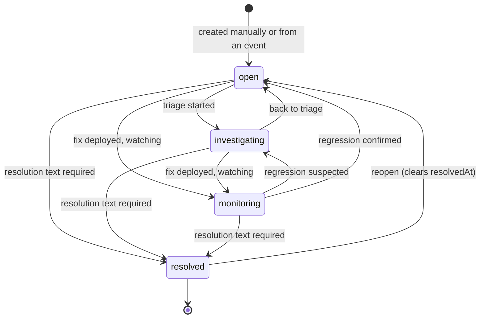
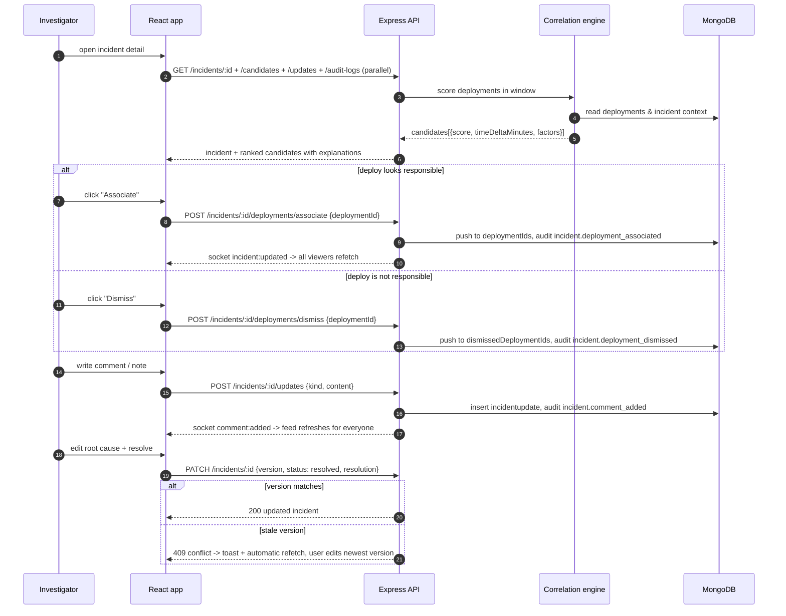
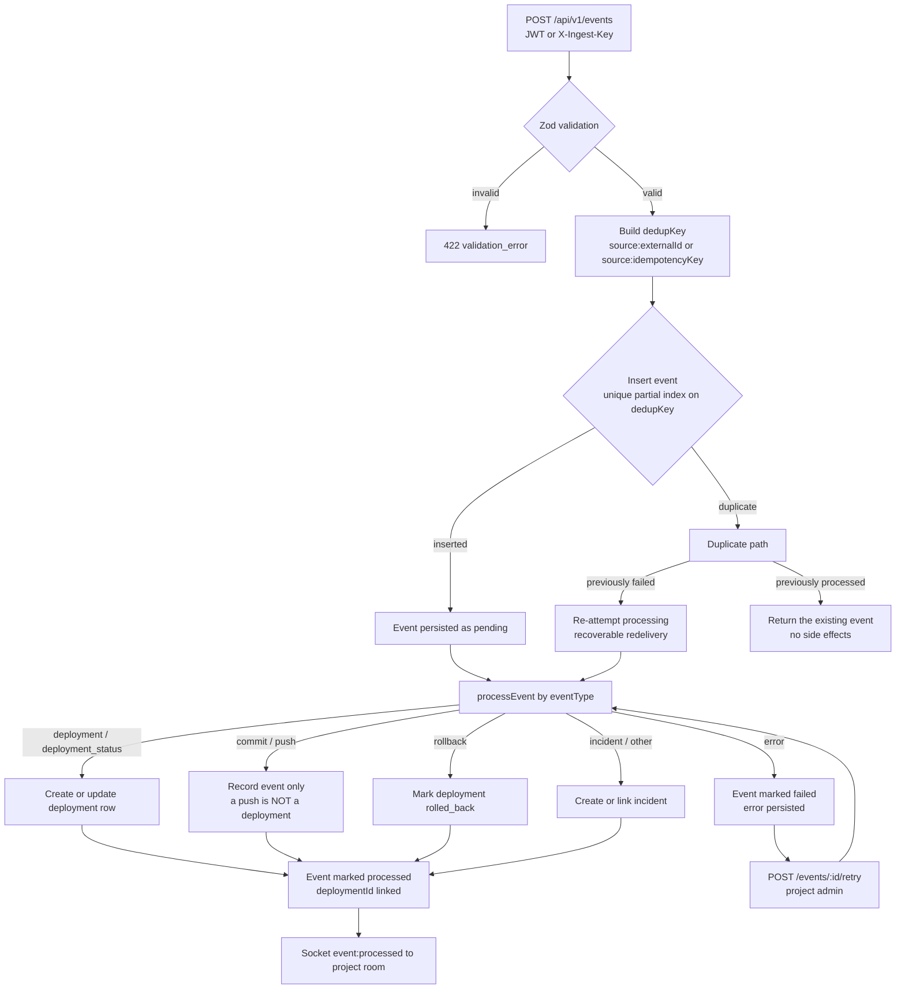
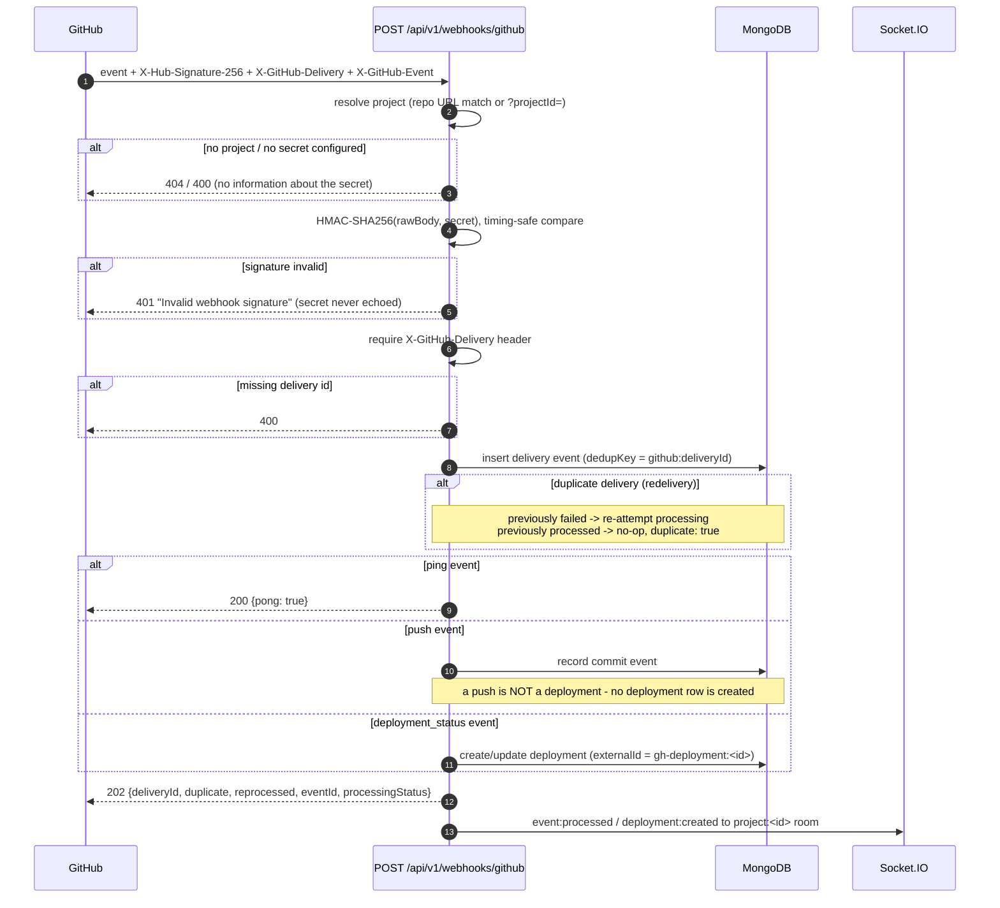

# BuildTrace — Workflows

Four workflows carry most of the product's behaviour: the incident lifecycle, the
investigation flow around the correlation engine, event ingestion, and the GitHub
webhook pipeline. Each is described with a diagram plus the exact rules enforced
by the server.

---

## 1. Incident lifecycle

The lifecycle is a validated state machine, not a free-form status field. The
allowed transitions live in `backend/src/utils/constants.js` (`INCIDENT_TRANSITIONS`)
and are enforced in `incidentService.updateIncident`.

Rules enforced server-side:

| Rule | Behaviour |
|------|-----------|
| Transition whitelist | Any status change not in the table above → `422` with the allowed next states |
| Resolution required | `status → resolved` without `resolution` text → `422`; the server never fabricates a resolution |
| `resolvedAt` managed by the server | Set on resolve, cleared on reopen — clients cannot set it directly |
| Optimistic concurrency | Every `PATCH /incidents/:id` must send the `version` last read; the write is a single conditional `findOneAndUpdate({_id, version})`. A stale `version` → `409` and the client refetches the newest state |
| Audit trail | Every update writes `incident.updated` with before/after snapshots |
| Activity feed | Status changes automatically append a `status_change` entry to `incidentupdates` so the investigation timeline is complete |

---

## 2. Investigation flow

How an investigator moves from "something is broken" to a confirmed root cause.

Correlation context (details in [architecture.md](./architecture.md)):

- Window: `CORRELATION_WINDOW_MINUTES` (default 60) before the incident's `createdAt`.
- Score: weighted sum — proximity `0.45`, environment `0.20`, service `0.20`,
  change signals `0.15` — each factor reported per candidate so the ranking is
  explainable, never a black box.
- When nothing clears the bar, the API returns an explicit
  `noneFoundMessage` instead of an empty silent list.
- Suggestions are computed, never persisted. Only investigator decisions
  (associate / dismiss) are stored, and dismissed candidates never reappear.

---

## 3. Event ingestion pipeline

Every fact in BuildTrace (deployments, commits, incidents from integrations)
enters through the same pipeline. Deduplication happens in the database via a
unique partial index on `dedupKey`, so concurrent duplicates cannot race.

Key rules:

| Rule | Behaviour |
|------|-----------|
| Late arrivals | `occurredAt` (true time) and `receivedAt` (ingestion time) are stored separately; the timeline sorts by `occurredAt`, so a late event still appears in its true position |
| Uncertain timestamps | When the source provides no reliable occurrence time, `occurredAt` falls back to receipt and `timestampUncertain` is flagged — visible in the UI, never silently trusted |
| Dedup identity | `source:externalId` (GitHub delivery id, CI run id) or `source:idempotencyKey` (client supplied). Internal events have no identity and are never merged |
| Recoverable failures | A failed event keeps its `error` and `retryCount`; a redelivery or an explicit retry re-runs processing on the same row — side effects are never duplicated |
| `occurredAt` guard on deployments | Out-of-order status updates are rejected against `lastStatusAt`, so a stale webhook cannot overwrite a newer state |

---

## 4. GitHub webhook flow

`POST /api/v1/webhooks/github` is public but authenticated by HMAC. The route is
mounted with a raw-body parser **before** `express.json()` so the signature is
computed over the exact bytes GitHub sent.

Operational notes:

- GitHub treats any 2xx as success; `202 Accepted` reflects that processing is
  asynchronous relative to the HTTP response.
- Redeliveries from GitHub's UI hit the same `dedupKey`: an event that previously
  failed is genuinely re-processed; one that already succeeded is a safe no-op.
- Failures are visible: the raw event row stays with `processingStatus: failed`,
  the error message is persisted, and a project admin can retry from the app.
- `backend/scripts/verify-webhooks.py` reproduces this whole flow end-to-end
  (12 checks) against a running server.

---

## Socket.IO notifications

Realtime is notification-only: payloads carry identifiers, never state. Clients
respond by refetching through the REST API (which re-applies authorization and
freshness), so a socket message can never leak data a request would not return.

| Event | Emitted when | Room |
|-------|--------------|------|
| `incident:created` | incident created (manual or from event) | `project:<id>` |
| `incident:updated` | incident patched, associated, dismissed | `project:<id>` |
| `incident:deleted` | incident deleted (admin) | `project:<id>` |
| `comment:added` | activity feed entry created | `project:<id>` |
| `deployment:created` | deployment recorded (manual, event, webhook) | `project:<id>` |
| `deployment:updated` | deployment status changed | `project:<id>` |
| `event:processed` | ingestion finished (success or failure) | `project:<id>` |

Handshake authentication uses the same JWT (`auth.token`); membership in the
requested project room is verified before joining. See
`backend/scripts/verify-sockets.mjs` (9 checks) for the executable spec.
